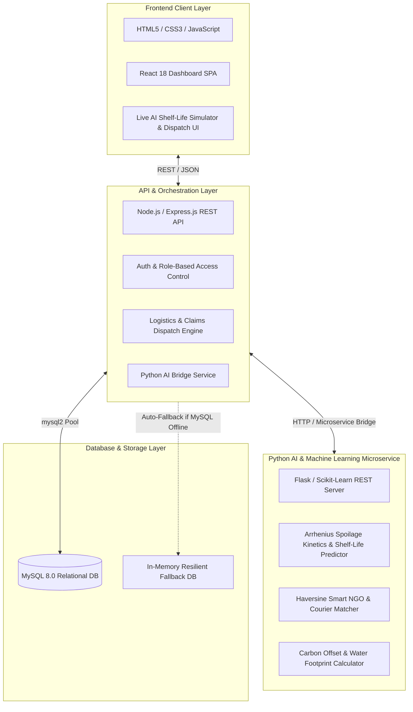

# 🌱 FoodRescue.ai - Full-Stack Surplus Food Recovery Platform

An end-to-end full-stack intelligent surplus food rescue and redistribution ecosystem connecting food donors (restaurants, hotels, supermarkets, bakeries) with recipient NGOs, shelters, community food banks, and volunteer courier riders.

The platform integrates **machine learning deterioration kinetics** and **geodesic proximity algorithms** to prevent food spoilage, enforce cold-chain food safety, and measure environmental sustainability metrics (CO₂e reduction, water footprint conservation).

---

## 🏗️ Architecture Overview



---

## 🛠️ Tech Stack Breakdown

| Technology | Role in Architecture |
|---|---|
| **HTML5 & CSS3** | Semantic layout, CSS variables, glassmorphic UI, responsive layouts, color-coded priority alerts |
| **JavaScript (ES6+)** | Dynamic DOM updates, asynchronous data fetching, client-side Arrhenius kinetics simulation |
| **React 18** | Modular SPA architecture, dynamic state management (`useState`, `useEffect`, `useMemo`), real-time dispatch timelines, interactive parameter controls |
| **Node.js & Express** | RESTful API server, routing, JWT authentication, request validation, error handling, microservice bridging |
| **MySQL 8.0+** | Relational data persistence with strict foreign keys, indexes, triggers, and impact audit logs |
| **Python 3.x** | Machine learning and kinetic algorithms (Shelf life decay modeling, Haversine geospatial matching, environmental offset calculation) |

---

## 📂 Project Structure

```
food rescue/
├── README.md                          # Comprehensive project documentation
│
├── database/                          # MySQL Database Layer
│   ├── schema.sql                     # Full relational DDL (Tables, Foreign Keys, Indexes, Views)
│   └── seed.sql                       # Realistic seed data (Donors, Shelters, Couriers, Listings)
│
├── backend/                           # Node.js Express REST API
│   ├── package.json                   # Dependencies: express, mysql2, cors, jsonwebtoken, dotenv
│   ├── server.js                      # Main server entrypoint (Port 5000)
│   ├── .env                           # Environment configuration
│   ├── config/
│   │   └── db.js                      # MySQL connection pool + automatic fallback engine
│   ├── controllers/
│   │   ├── authController.js          # Authentication & profile management
│   │   ├── donationController.js      # Food surplus listings & AI shelf-life integration
│   │   ├── rescueController.js        # Claims, status dispatching, and quality logs
│   │   ├── analyticsController.js     # Carbon and operational impact metrics
│   │   └── aiController.js            # Endpoints bridging Python ML capabilities
│   ├── middleware/
│   │   ├── authMiddleware.js          # JWT verification & role authorization
│   │   └── errorHandler.js            # Centralized error handler
│   ├── routes/                        # Express API route modules
│   └── services/
│       ├── pythonBridge.js            # Bridge to Python AI with embedded JS fallback
│       └── mockDb.js                  # In-memory mock data for offline/standalone execution
│
├── frontend/                          # Web UI Layer
│   ├── index.html                     # Instant zero-config runnable React 18 SPA preview
│   ├── css/
│   │   └── styles.css                 # Custom responsive design system
│   ├── js/
│   │   └── app.js                     # React 18 component application
│   ├── package.json                   # Standard React + Vite setup
│   ├── vite.config.js                 # Vite build & development server config
│   └── src/                           # Modern modular React components
│       ├── App.jsx
│       ├── main.jsx
│       └── index.css
│
├── python_ai_service/                 # Python AI & Machine Learning Microservice
│   ├── requirements.txt               # Dependencies: flask, flask-cors, numpy, scikit-learn
│   ├── app.py                         # Flask REST API Server (Port 5001)
│   ├── shelf_life_model.py            # Arrhenius kinetic deterioration & microbial danger model
│   ├── smart_matcher.py               # Haversine distance & capacity matching engine
│   ├── impact_calculator.py           # Carbon offset & embedded water footprint engine
│   ├── train_model.py                 # ML data generation & model training script
│   └── sample_test.py                 # Standalone terminal verification script
│
└── scripts/                           # Execution & Setup Automation
    ├── run_all.bat                    # Master runner script
    ├── start_backend.bat              # Starts Node.js Express server
    ├── start_python.bat               # Starts Python AI microservice
    └── setup_mysql.bat                # Automates MySQL schema & seed import
```

---

## ⚡ Instant Quickstart

### Option 1: Open the Frontend Immediately (Zero Setup Required)
You can directly double-click or open:
```
c:\Users\shaik\Desktop\food rescue\frontend\index.html
```
in any web browser (Chrome, Edge, Firefox). The interface will instantly load with:
- The full Food Rescue board with urgency badges and filters
- Live AI Shelf-Life Simulator with interactive thermal danger zone sliders
- Smart NGO Matcher ranking shelters by distance and capacity
- Interactive "Post Donation" modal with dynamic pre-assessment
- Courier dispatch workflow with step-by-step handover tracking
- Environmental impact meters (CO₂ kg avoided, water liters conserved)

---

### Option 2: Running the Full Stack (Node + Python + MySQL)

#### 1. Setup MySQL Database
Ensure MySQL Server is running, then execute:
```bash
mysql -u root -p < database/schema.sql
mysql -u root -p < database/seed.sql
```
*(Or double-click `scripts/setup_mysql.bat`)*

#### 2. Start the Node.js Express Backend
```bash
cd backend
npm install
npm start
```
The server will boot on `http://localhost:5000`. If MySQL is not running, it automatically operates in resilient fallback mode without crashing.

#### 3. Start the Python AI Microservice
```bash
cd python_ai_service
pip install -r requirements.txt
python app.py
```
The AI microservice will start on `http://localhost:5001`.

#### 4. (Optional) Run React with Vite
```bash
cd frontend
npm install
npm run dev
```

---

## 🤖 AI & Machine Learning Details

### 1. Spoilage Kinetics & Shelf-Life Predictor (`shelf_life_model.py`)
Predicts microbial and chemical deterioration using a modified temperature kinetic function:
$$k(T) = k_{\text{ref}} \cdot Q_{10}^{\frac{T - T_{\text{ref}}}{10}}$$
- Evaluates **thermal danger zone** ($5^\circ\text{C} - 60^\circ\text{C}$) where microbial reproduction is accelerated by $2.6\times$
- Accounts for packaging barrier coefficients (sealed gastronorm vs open trays)
- Dynamically assigns operational urgency: `CRITICAL` ($<3\text{h}$), `HIGH` ($<7\text{h}$), `MEDIUM` ($<18\text{h}$), `NORMAL`

### 2. Smart Rescue Matcher (`smart_matcher.py`)
Calculates the shortest great-circle distance between donor, shelters, and courier bikes using the **Haversine formula**:
$$d = 2R \arcsin\left(\sqrt{\sin^2\left(\frac{\Delta\phi}{2}\right) + \cos(\phi_1)\cos(\phi_2)\sin^2\left(\frac{\Delta\lambda}{2}\right)}\right)$$
- Blends distance proximity ($40\%$), shelter capacity ($25\%$), dietary match ($20\%$), and priority urgency ($15\%$) to output a normalized Match Score ($0 - 100\%$).

### 3. Carbon & Water Footprint Engine (`impact_calculator.py`)
Based on UN FAO benchmarks:
- **Cooked Meals**: $3.25\text{ kg CO}_2\text{e}$ and $1,600\text{ L}$ embedded water saved per kg
- **Produce**: $1.20\text{ kg CO}_2\text{e}$ and $550\text{ L}$ water saved per kg
- Computes tangible community equivalents (passenger vehicle kilometers prevented, household shower equivalents, annual tree absorption).

---

## 📡 REST API Reference

### Food Donations
- `GET /api/donations`: List surplus listings with filters (`status`, `food_type`, `priority`)
- `GET /api/donations/:id`: Retrieve single donation detail
- `POST /api/donations`: Post new surplus batch (triggers AI shelf-life assessment)
- `PATCH /api/donations/:id/status`: Update listing status (`AVAILABLE`, `CLAIMED`, `DELIVERED`)

### Rescue Operations & Dispatch
- `GET /api/rescues`: Retrieve claims and active courier deliveries
- `POST /api/rescues/claim`: Claim a donation for an NGO/shelter
- `PATCH /api/rescues/:id/status`: Update transit status (`IN_TRANSIT`, `DELIVERED`) and log cold-chain probe temperature

### AI Microservice
- `POST /api/ai/predict-shelf-life`: Calculate remaining safe hours & freshness score
- `POST /api/ai/smart-match`: Rank shelters and assign optimal volunteer couriers
- `POST /api/ai/calculate-impact`: Generate carbon offset & water footprint metrics

---

## 📄 License
MIT License. Open-source food rescue project for zero waste and community food security.
